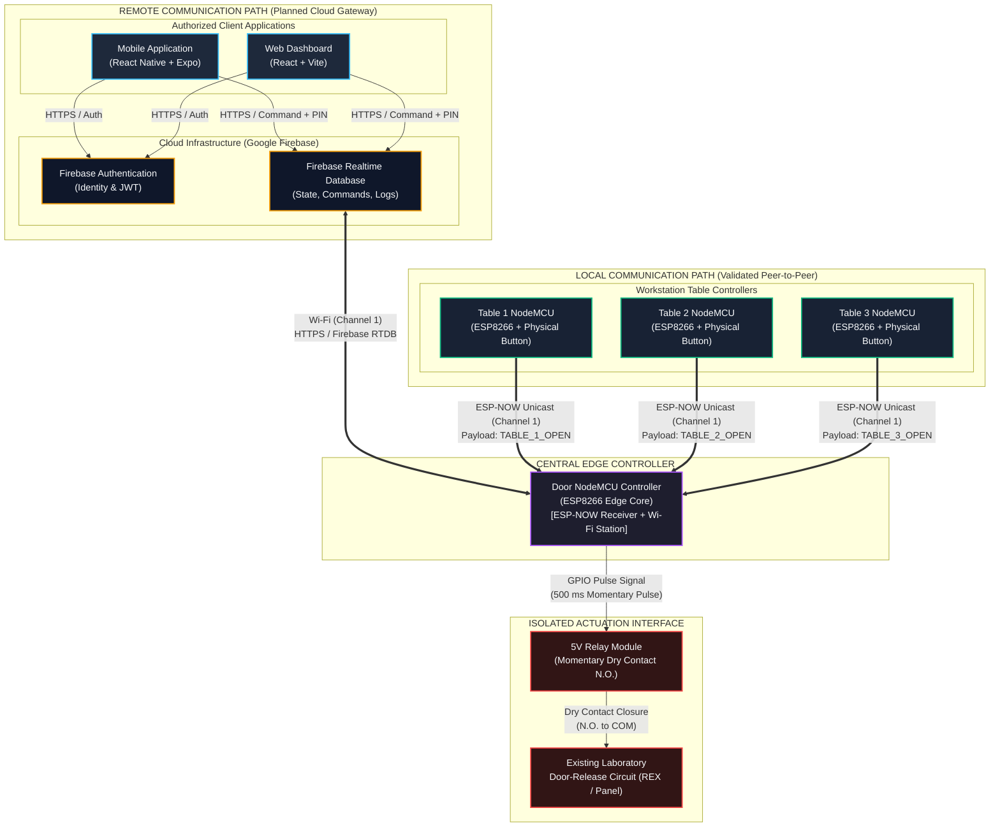

# VAJRAX Smart Door — System & Technical Architecture Specification

**Document Version:** 1.0.0
**Project:** VAJRAX Smart Door — Robotics Laboratory Access Control System
**Status:** Active Development / Architecture Baseline
**Target Repository:** `vajrax-smart-door`

---

## 1. Architecture Overview

The **VAJRAX Smart Door** system is an edge-centric, multi-modal access-control architecture designed specifically for a robotics research laboratory. In such an environment, researchers and engineers working at distributed assembly benches require fast, low-latency physical door-release control without abandoning active experiments, handling delicate hardware, or depending on active internet service. Simultaneously, laboratory managers require remote, audited, authenticated cloud ingress triggers and status monitoring.

To satisfy these contrasting operational demands without compromise, the system implements a bifurcated dual-path architecture:
1. **The Local Access Path (Validated & Working):** A direct, peer-to-peer radio frequency link utilizing the connectionless **ESP-NOW** protocol operating on the 2.4 GHz ISM band. Workstation Table Nodes (Table 1, Table 2, Table 3) communicate directly with the Door Controller Node via ESP-NOW unicast, actuating a relay interface momentarily upon a physical button press completely independent of local routers, gateways, or the internet.
2. **The Remote Access Path (Planned / Development Stage):** A cloud-mediated control loop utilizing **Google Firebase** (Authentication and Realtime Database) bridging cross-platform client applications (**React Native / Expo** on mobile and **React / Vite** on web) to the Door Controller Node over standard 802.11 b/g/n Wi-Fi.

The system acts strictly as an **authorized auxiliary door-release trigger**. It interfaces with the laboratory's door release circuit (such as a Request-to-Exit / REX loop or access-control power supply trigger) via a relay contact. The system generates a controlled momentary release signal; it does not directly drive or power lock motor coils, and it does not bypass or disable existing laboratory fingerprint scanners, card readers, or physical deadbolts.

---

## 2. Design Goals

The VAJRAX Smart Door architecture is governed by five foundational engineering principles:

- **DG-1: Local Autonomy & Zero WAN Dependency:** Local door actuation from workstation tables must function unconditionally, even during total local router failure, Wi-Fi disconnect, or external internet outages.
- **DG-2: Low-Latency Local Actuation:** Local actuation should provide a fast and consistent response suitable for laboratory door-release operation. Actual end-to-end latency will be measured and documented during system validation.
- **DG-3: Defense-in-Depth Cloud Security:** Remote door actuation must enforce account authentication plus an independent numeric Door PIN, and strict Role-Based Access Control (RBAC).
- **DG-4: Safe Electrical Default:** Power interruption, firmware crash, brownout, or reboot should leave the relay de-energized and should not intentionally trigger the door-release circuit. The physical lock behavior depends on the existing laboratory access-control hardware and must be validated separately.
- **DG-5: Radio Coexistence & Shared-Phy Alignment:** The central edge controller must maintain concurrent operation between connectionless ESP-NOW frame reception and connection-oriented 802.11 b/g/n station infrastructure mode by strictly matching operational RF channels.

---

## 3. High-Level System Architecture

The system decouples local physical bench triggers from remote application clients while converging both control vectors onto the Door NodeMCU as the single authoritative edge gateway.

### 3.1 Architectural Diagram



### 3.2 Path Differentiation

| Architectural Property | Local Path (`LOCAL`) | Remote Path (`REMOTE`) |
|---|---|---|
| **Origin / Ingress** | Table 1, Table 2, Table 3 push buttons | Mobile App (Expo) / Web Dashboard (Vite) |
| **Protocol** | ESP-NOW (2.4 GHz raw MAC layer frames) | HTTPS / Firebase Realtime Database communication |
| **Intermediary Broker** | None (direct peer-to-peer RF) | Firebase Authentication & Realtime Database |
| **Network Reliance** | Zero. Independent of router, AP, and WAN. | Requires active Wi-Fi AP and internet uplink. |
| **Authentication Model** | MAC address recognition & hardcoded payload validation | Firebase user session token + secondary Door PIN |
| **Primary Safety Function** | Immediate lab egress/ingress convenience | Audited administrative & remote access |
| **Deployment Status** | **Implemented & Bench Validated** | **Planned / Under Development** |

---

## 4. Local Communication Architecture

The local communication architecture provides reliable, low-latency door actuation directly from physical workbenches to the Door NodeMCU.

```
+------------------+         +-------------------+         +------------------+
|  Table 1 Button  |         |  Table 2 Button   |         |  Table 3 Button  |
+--------+---------+         +---------+---------+         +--------+---------+
         | Momentary                   | Momentary                  | Momentary
         | Contact                     | Contact                    | Contact
         v                             v                            v
+--------+---------+         +---------+---------+         +--------+---------+
|  Table 1 NodeMCU |         |  Table 2 NodeMCU  |         |  Table 3 NodeMCU |
+--------+---------+         +---------+---------+         +--------+---------+
         |                             |                            |
         | ESP-NOW (Ch 1)              | ESP-NOW (Ch 1)             | ESP-NOW (Ch 1)
         | "TABLE_1_OPEN"              | "TABLE_2_OPEN"             | "TABLE_3_OPEN"
         +-----------------------------+----------------------------+
                                       |
                                       v
                        +--------------+--------------+
                        |      Door NodeMCU Core      |
                        | (ESP-NOW Receive Callback)  |
                        +--------------+--------------+
                                       |
                                       v
                        +--------------+--------------+
                        |   Command Identification &  |
                        |      Payload Validation     |
                        +--------------+--------------+
                                       | Valid command matched
                                       v
                        +--------------+--------------+
                        |     Relay GPIO Energized    |
                        |    (500 ms Momentary Pulse) |
                        +--------------+--------------+
                                       |
                                       v
                        +--------------+--------------+
                        |     Relay Dry Contact       |
                        |   Momentary Door Release    |
                        +-----------------------------+
```

### 4.1 Physical Button Input & Debouncing
Each table controller (Table 1, Table 2, Table 3) monitors a normally open (NO) mechanical tactile push button wired between a designated GPIO pin and Ground.
- The GPIO is configured with an internal pull-up resistor (`INPUT_PULLUP`).
- Active button depression pulls the logic level to `LOW`.
- Firmware implements software debouncing requiring the pin to remain in a stable `LOW` state for a minimum of 50 ms before registering a valid actuation event. This eliminates false double-triggers caused by mechanical contact chatter.

### 4.2 ESP-NOW Frame Construction & Transmission
ESP-NOW is a connectionless, vendor-specific communication protocol developed by Espressif operating on the 2.4 GHz physical layer (OSI Layers 1 and 2):
- Upon a validated button depression, the Table NodeMCU packages a fixed ASCII command string into an ESP-NOW packet payload.
- The transmission destination is configured to the Door NodeMCU's specific registered MAC address (unicast).
- The transmission executes synchronously without requiring handshakes, network association, or DHCP IP assignment. Total RF on-air transmission time is typically under 5 ms.

### 4.3 Confirmed Local Command Set
The firmware across the three table nodes transmits the following immutable, confirmed command strings:

| Origin Node | Physical Hardware | Confirmed Command String | Packet Size |
|---|---|---|---|
| **Table 1** | ESP8266 NodeMCU + Button 1 | `TABLE_1_OPEN` | 12 Bytes |
| **Table 2** | ESP8266 NodeMCU + Button 2 | `TABLE_2_OPEN` | 12 Bytes |
| **Table 3** | ESP8266 NodeMCU + Button 3 | `TABLE_3_OPEN` | 12 Bytes |

### 4.4 Door NodeMCU Reception & Command Identification
The Door NodeMCU registers an asynchronous receive callback routine (`esp_now_register_recv_cb`).
1. When an incoming 2.4 GHz RF frame matching the ESP-NOW protocol signature arrives on Channel 1, the hardware MAC interrupt fires.
2. The callback extracts the sender's MAC address and byte payload.
3. The payload is checked against known command signatures:
   ```cpp
   if (strcmp(incomingPayload, "TABLE_1_OPEN") == 0) {
       triggerDoorRelease("TABLE_1");
   } else if (strcmp(incomingPayload, "TABLE_2_OPEN") == 0) {
       triggerDoorRelease("TABLE_2");
   } else if (strcmp(incomingPayload, "TABLE_3_OPEN") == 0) {
       triggerDoorRelease("TABLE_3");
   }
   ```
4. If the payload does not strictly match one of the three recognized commands, the frame is discarded immediately.

### 4.5 Momentary Relay Activation Behavior
- Upon command validation, the Door NodeMCU transitions its relay control GPIO from its idle state to its active state.
- A non-blocking timer (using `millis()` or an asynchronous timer ticker) is initiated for the configured pulse duration of approximately **500 ms**.
- While active, the relay dry contacts (Normally Open to Common) close, completing the laboratory door-release circuit.
- After 500 ms, the timer expires and the GPIO transitions back to the idle de-energized state, breaking the contact.
- Subsequent button presses received while the relay is actively pulsing are ignored or re-trigger the pulse window without causing relay contact jitter.

---

## 5. Remote Communication Architecture

The remote communication architecture enables authenticated laboratory personnel to release the door and inspect telemetry from outside the direct line of sight or off-site.

> [!NOTE]
> **Implementation Status:** The remote communication path is currently in the **planned / development stage**. The software specifications, database schema, and client protocols below represent the architectural baseline for implementation.

```
+-------------------------------------------------------------------------+
|                  Step 1: User Identity Authentication                   |
|                                                                         |
|  [ User on Mobile / Web ] ---> Firebase Authentication (Email/Password)  |
|                           <--- Returns Signed JSON Web Token (JWT)      |
+------------------------------------+------------------------------------+
                                     |
                                     v
+-------------------------------------------------------------------------+
|               Step 2: Dual-Layer Authorization (Door PIN)               |
|                                                                         |
|  [ Client Enters Door PIN ] ---> Door PIN verification must be enforced |
|    by a trusted authorization layer; client-side validation may provide  |
|    UI feedback but must not be the sole security control.                |
+------------------------------------+------------------------------------+
                                     |
                                     v
+-------------------------------------------------------------------------+
|                  Step 3: Database Command Dispatch                      |
|                                                                         |
|  Client writes to Firebase Realtime Database:                           |
|  PATH: /commands/doorRelease                                            |
|  PAYLOAD: { "uid": "...", "timestamp": 1718000000, "status": "PENDING" }|
+------------------------------------+------------------------------------+
                                     |
                                     v
+-------------------------------------------------------------------------+
|                 Step 4: Door NodeMCU Wi-Fi Ingestion                    |
|                                                                         |
|  Door NodeMCU (Connected to Lab Wi-Fi on Channel 1)                     |
|  Monitors /commands/doorRelease (mechanism finalized during development) |
|  - Validates remoteAccessEnabled == true                                |
|  - Validates timestamp freshness (delta < 10.0s)                        |
+------------------------------------+------------------------------------+
                                     |
                                     v
+-------------------------------------------------------------------------+
|                 Step 5: Actuation & Audit Synchronization                |
|                                                                         |
|  - Energizes Relay for 500 ms momentary pulse                            |
|  - Writes Audit Log to /logs (source: "MOBILE_APP" / "WEB_DASHBOARD")   |
|  - Clears / acknowledges command in /commands/doorRelease               |
+-------------------------------------------------------------------------+
```

### 5.1 Step-by-Step Planned Flow
1. **Identity Authentication:** The client launches the React Native or Vite web app and authenticates against Firebase Authentication with an authorized email and password. A signed JWT is returned and held securely in local storage.
2. **Door PIN Verification:** To initiate an unlock, the user must enter an independent 4-to-6 digit numeric Door PIN. This prevents unauthorized releases in the event that an unlocked mobile phone or active workstation session is left unattended.
3. **Command Generation:** Upon PIN validation, the client issues an authenticated `PUT` or `PUSH` request to `/commands/doorRelease` containing:
   - `commandId`: Unique UUID.
   - `uid`: Authenticated user's Firebase UID.
   - `timestamp`: UTC millisecond server timestamp (`ServerValue.TIMESTAMP`).
   - `status`: `"PENDING"`.
4. **Edge Ingestion:** The Door NodeMCU, connected to the local 2.4 GHz Wi-Fi router on Channel 1, will communicate with Firebase Realtime Database using the implementation finalized during development to monitor `/commands/doorRelease`.
5. **Command Validation:** The Door NodeMCU verifies:
   - Global administrative flag `/systemControl/remoteAccessEnabled` is `true`.
   - The command timestamp is fresh (less than 10.0 seconds old) to avoid executing stale queued requests after network reconnections.
6. **Actuation & State Acknowledgment:** The Door NodeMCU activates the relay for the configured momentary pulse (approximately 500 ms), transitions the command record to `"COMPLETED"`, updates the last known relay state under `/status/doorController`, and appends an immutable entry to `/logs`.

---

## 6. Door NodeMCU Responsibilities

The Door NodeMCU functions as the central edge controller and physical bridge between the local RF domain, the cloud broker, and the door release hardware.

### 6.1 Responsibility Breakdown

```
+---------------------------------------------------------------------------+
|                          DOOR NODEMCU CONTROLLER                          |
|                                                                           |
|   +--------------------------+             +--------------------------+   |
|   |   ESP-NOW Radio Stack    |             |    Wi-Fi Radio Stack     |   |
|   |  - Channel 1 Receiver    |             |  - 802.11 b/g/n Station  |   |
|   |  - Table MAC Validation  |             |  - Channel 1 Matched     |   |
|   |  - Packet Identification |             |  - Firebase RTDB Client  |   |
|   +------------+-------------+             +------------+-------------+   |
|                |                                        |                 |
|                +-------------------+--------------------+                 |
|                                    |                                      |
|                                    v                                      |
|                     +-----------------------------+                       |
|                     |     Command Arbitrator &    |                       |
|                     |     Validation Engine       |                       |
|                     | - Safe pulse window         |                       |
|                     | - Remote lockout check      |                       |
|                     | - Timestamp expiry verify   |                       |
|                     +--------------+--------------+                       |
|                                    |                                      |
|                                    v                                      |
|                     +-----------------------------+                       |
|                     |    Isolated GPIO Actuation  |                       |
|                     |  - Glitch-free boot logic   |                       |
|                     |  - 500 ms Momentary Pulse   |                       |
|                     |  - Watchdog monitored       |                       |
|                     +-----------------------------+                       |
+---------------------------------------------------------------------------+
```

### 6.2 Implementation Status of Door Controller Responsibilities

| Responsibility | Architectural Function | Implementation Status |
|---|---|---|
| **ESP-NOW Receiver** | Listens on Channel 1 for incoming frames; triggers MAC interrupt callback. | **Implemented & Validated** |
| **Local Command Identification** | Evaluates payloads (`TABLE_1_OPEN`, `TABLE_2_OPEN`, `TABLE_3_OPEN`). | **Implemented & Validated** |
| **Relay Actuation Control** | Drives relay pin for approximately 500 ms with non-blocking timing. | **Implemented & Validated** |
| **Safe Relay Boot State** | The relay control output remains de-energized during cold boot, reset, and initialization. | **Implemented & Validated** |
| **Wi-Fi Station Association** | Associates with laboratory 2.4 GHz Access Point on Channel 1. | **Planned / In Development** |
| **Firebase Cloud Client** | Subscribes to `/commands` and `/systemControl` endpoints. | **Planned / In Development** |
| **Remote Command Validation** | Checks timestamp validity (< 10s) and lockout flags before firing relay. | **Planned / In Development** |
| **Device Heartbeat Publisher** | Periodically writes RSSI, uptime, and status to `/status/doorController`. | **Planned / In Development** |
| **Local-to-Cloud Log Dispatch** | Mirrors local ESP-NOW triggers to cloud `/logs` when Wi-Fi is connected. | **Planned / In Development** |

---

## 7. Table NodeMCU Responsibilities

The three Table NodeMCUs (Table 1, Table 2, Table 3) operate as lightweight, edge-of-workbench transmitters.

### 7.1 Architecture of Table Nodes
- **Dedicated Functionality:** Each table controller has a single deterministic role: sense the physical button depression, debounce the mechanical contacts, package the specific table command, and transmit it over ESP-NOW.
- **Zero Cloud Burden:** Table nodes do not load the Wi-Fi station stack, do not negotiate DHCP IP addresses, do not store cloud credentials, and do not make internet connections.
- **Fast Startup:** Table nodes do not require network association before servicing local button events and are designed for fast recovery after power restoration. Actual startup time will be measured during validation.

### 7.2 Functional Summary

| Table Node | Input Pin | Debounce Mechanism | Dedicated Payload | Destination |
|---|---|---|---|---|
| **Table 1 Controller** | GPIO Input (`INPUT_PULLUP`) | 50 ms software timer | `TABLE_1_OPEN` | Door NodeMCU MAC |
| **Table 2 Controller** | GPIO Input (`INPUT_PULLUP`) | 50 ms software timer | `TABLE_2_OPEN` | Door NodeMCU MAC |
| **Table 3 Controller** | GPIO Input (`INPUT_PULLUP`) | 50 ms software timer | `TABLE_3_OPEN` | Door NodeMCU MAC |

---

## 8. Communication Protocols

| Protocol | Purpose | Direction | Subsystem | Current / Planned Status |
|---|---|---|---|---|
| **ESP-NOW** | Low-latency, connectionless peer-to-peer unicast transmission of button actuation commands over 2.4 GHz raw RF frames. | Unicast from Table 1, 2, 3 to Door Controller Node MAC address. | Local Subsystem | **Currently Validated & Working** |
| **802.11 b/g/n Wi-Fi** | Local area wireless network connection linking Door NodeMCU to the lab router. Operates strictly on Channel 1. | Bi-directional between Door Controller Node and Lab Wi-Fi AP. | Edge-to-Cloud Subsystem | **Planned / Under Development** |
| **HTTPS (TLS 1.2/1.3)** | Secure transport protocol for user authentication, initial token exchange, and REST operations. | Bi-directional between Mobile/Web clients and Firebase Cloud. | Application-to-Cloud Subsystem | **Planned / Under Development** |
| **Firebase Realtime Database** | Bi-directional state synchronization, command queuing, telemetry streaming, and activity audit logging. The exact ESP8266-to-Firebase communication mechanism will be finalized during implementation. | Bi-directional between Firebase Cloud, Clients, and Door Controller. | Cloud Integration Subsystem | **Planned / Under Development** |
| **Firebase Authentication** | Identity management, credential verification, and JSON Web Token (JWT) issuance. | Inbound from Mobile/Web clients to Firebase Auth servers. | Security & Identity Subsystem | **Planned / Under Development** |

---

## 9. Network Architecture & Radio Coexistence

### 9.1 The Shared-Radio Constraint
The ESP8266 SoC contains a **single physical 2.4 GHz RF transceiver** and baseband processor shared between the Wi-Fi subsystem and the ESP-NOW subsystem. The hardware cannot tune to two different radio frequencies simultaneously.

```
+-------------------------------------------------------------------------+
|                  ESP8266 PHYSICAL RADIO COEXISTENCE                     |
|                                                                         |
|                +---------------------------------------+                |
|                |   Single 2.4 GHz Radio Transceiver    |                |
|                +-------------------+-------------------+                |
|                                    |                                    |
|                     Locked to: RF CHANNEL 1                             |
|                                    |                                    |
|         +--------------------------+--------------------------+         |
|         |                                                     |         |
|         v                                                     v         |
|  +--------------+                                      +--------------+ |
|  |   ESP-NOW    |                                      |  802.11 STA  | |
|  |  Subsystem   |                                      |  Subsystem   | |
|  +-------+------+                                      +-------+------+ |
|          |                                                     |        |
+----------|-----------------------------------------------------|--------+
           |                                                     |
           v                                                     v
+-----------------------+                             +-----------------------+
| Table 1, 2, 3 Nodes   |                             | Lab Wi-Fi Router / AP |
| (Unicast on Ch 1)     |                             | (Operating on Ch 1)   |
+-----------------------+                             +-----------------------+
```

### 9.2 Channel Compatibility & The Channel 1 Imperative
1. **Wi-Fi Infrastructure Dictation:** When an ESP8266 associates with a Wi-Fi Access Point (AP), its internal radio frequency automatically locks to the primary operating channel dictated by that AP's beacon.
2. **ESP-NOW Channel Lock:** While in station (`STA`) mode, any ESP-NOW packet sent or received by that ESP8266 will be processed **only** on the channel to which the radio is currently locked.
3. **Architectural Solution:** The laboratory Wi-Fi router is statically assigned to **Wi-Fi Channel 1** (2412 MHz). Consequently:
   - Table 1 NodeMCU is fixed to transmit ESP-NOW on **Channel 1**.
   - Table 2 NodeMCU is fixed to transmit ESP-NOW on **Channel 1**.
   - Table 3 NodeMCU is fixed to transmit ESP-NOW on **Channel 1**.
   - Door NodeMCU associates with the lab AP on **Channel 1**, allowing its ESP-NOW receiver to capture table frames concurrently without radio re-tuning or frame dropping.

---

## 10. Cloud Architecture

The cloud architecture utilizes Google Firebase to provide a serverless, highly responsive state machine and authentication barrier without requiring self-hosted web servers or complex database maintenance.

### 10.1 Realtime Database Schema Structure

```json
{
  "systemControl": {
    "remoteAccessEnabled": true,
    "pulseDurationMs": 500,
    "doorPinHash": "e2fc714c4727ee9395f324cd2e7f331f"
  },
  "status": {
    "doorController": {
      "online": true,
      "lastSeen": 1718000000000,
      "relayState": "IDLE",
      "uptimeSeconds": 86400,
      "wifiRSSI": -58,
      "channel": 1
    }
  },
  "commands": {
    "doorRelease": {
      "commandId": "cmd-8823-9912",
      "requestedBy": "user_uid_12345",
      "clientType": "MOBILE_APP",
      "timestamp": 1718000000000,
      "status": "PENDING"
    }
  },
  "logs": {
    "-NxyZaBcDeFgHiJk": {
      "timestamp": 1718000000000,
      "source": "TABLE_1",
      "triggeredBy": "LOCAL_HARDWARE",
      "action": "DOOR_RELEASE",
      "status": "SUCCESS"
    },
    "-NxyZaBcDeFgHiJm": {
      "timestamp": 1718000025000,
      "source": "MOBILE_APP",
      "triggeredBy": "user_uid_12345",
      "action": "DOOR_RELEASE",
      "status": "SUCCESS"
    }
  },
  "users": {
    "user_uid_12345": {
      "email": "researcher@vajrax.lab",
      "displayName": "Lead Roboticist",
      "role": "admin",
      "isActive": true
    }
  }
}
```

### 10.2 Architectural Cloud Boundaries
- **No Cloud Functions:** The system core does not require custom Node.js Cloud Functions. Logic is cleanly divided between client-side validation rules, Firebase Realtime Database Security Rules, and edge microcontroller firmware.
- **Command Life Cycle:** Commands in `/commands/doorRelease` follow an atomic lifecycle: `PENDING` -> `PROCESSING` -> `COMPLETED` (or pruned), preventing duplicate executions.

---

## 11. Security Architecture

The system enforces defense-in-depth across both physical radio interfaces and internet endpoints.

### 11.1 Security Controls Matrix

```
+---------------------------------------------------------------------------+
|                        LAYERED SECURITY ARCHITECTURE                      |
|                                                                           |
|   [ Layer 1: Physical Perimeter ]                                         |
|   - Existing fingerprint scanner & manual deadbolts remain authoritative  |
|   - System relay acts only as parallel momentary exit / release signal    |
|                                                                           |
|   [ Layer 2: Local Radio Security (ESP-NOW) ]                             |
|   - MAC address whitelisting on Door NodeMCU                              |
|   - Exact payload string validation (rejects invalid byte lengths)        |
|                                                                           |
|   [ Layer 3: Remote Identity Authentication (Firebase Auth) ]             |
|   - Email / Password credential verification with signed JWT session      |
|                                                                           |
|   [ Layer 4: Secondary Door PIN Verification ]                            |
|   - Independent 4-to-6 digit numeric PIN required before command dispatch |
|   - Client-side 3-strike rate-limiting lockout                            |
|                                                                           |
|   [ Layer 5: Role-Based Authorization (RBAC & Security Rules) ]           |
|   - Admin vs. Standard User separation                                    |
|   - Database rules block unauthorized writes to /systemControl            |
|                                                                           |
|   [ Layer 6: Administrative Emergency Lockout ]                           |
|   - Master remoteAccessEnabled toggle immediately freezes remote triggers |
|                                                                           |
|   [ Layer 7: Replay & Stale Command Protection ]                          |
|   - Microcontroller discards cloud commands older than 10.0 seconds       |
+---------------------------------------------------------------------------+
```

### 11.2 Separation of Access Paths
Local table access and remote cloud access are logically separated. If a security anomaly or denial-of-service attack compromises the cloud credentials or internet link, setting `remoteAccessEnabled: false` isolates the door controller from remote commands while maintaining local bench button functionality.

---

## 12. Failure and Resilience Architecture

A fundamental architectural requirement of VAJRAX Smart Door is that **local operation must never fail when external dependencies fail**.

| Failure Event | Subsystem Impact | Expected Architectural Behavior | Recovery Mechanism |
|---|---|---|---|
| **Internet Outage** | Cloud unreachable; Mobile/Web release offline. | **Local table-button functionality remains available as long as the Door NodeMCU and ESP-NOW path remain powered and operational.** Door NodeMCU continues servicing ESP-NOW frames on Channel 1. | Planned behavior: the Door NodeMCU will retry the Firebase connection in the background with controlled backoff. |
| **Firebase Service Outage** | Remote commands cannot be read or dispatched. | Local table buttons continue normal operation. Client apps display a service degradation alert. | Planned behavior: firmware will re-establish the Firebase connection as soon as endpoints become reachable. |
| **Laboratory Wi-Fi AP Offline** | Door NodeMCU loses Wi-Fi station link. | Local ESP-NOW operates normally. Since AP is down, Door NodeMCU maintains Channel 1 reception. | Planned behavior: firmware will execute an auto-reconnect routine and reconnect to the AP as soon as the SSID beacon returns. |
| **Table NodeMCU Power Loss** | Specific table button non-functional. | Other two table nodes and all remote paths remain fully operational. | Hardware recovery upon power restoration. Actual startup time will be measured during validation. |
| **Door NodeMCU Reboot / Crash** | Momentary edge controller downtime during reboot. | Relay remains de-energized during boot (SAFE-001). Hardware Watchdog Timer reboots MCU. | Full re-initialization of ESP-NOW and Wi-Fi occurs upon reboot. Actual recovery time will be measured during validation. |
| **Stale / Delayed Cloud Command** | Queued command arrives minutes after network lag. | Door NodeMCU compares command timestamp against current time; commands > 10s old are silently discarded. | Prevents ghost unlock events after network restores. |
| **Relay Module Hardware Failure** | Contacts open or fail to switch. | Door release circuit is not intentionally energized by the failed relay. | Manual key or existing primary fingerprint scanner used for entry. |
| **Complete Lab AC Power Loss** | All controllers and door power drop. | The relay de-energizes. The resulting physical door state depends on the existing laboratory access-control hardware and must be validated separately. | Normal system boot sequence resumes automatically upon power restoration. |

---

## 13. Safety Architecture

1. **Controlled Momentary Release:** The currently validated Door NodeMCU firmware activates the relay for approximately 500 ms. Under no circumstances does the firmware leave the relay pin continuously energized.
2. **Safe Default Relay State:** The relay control output is assigned to a non-boot-strapping GPIO (e.g., `GPIO4` / `D2`). Upon power-up, brownout, reset, or unhandled crash, this pin remains high-impedance / low, keeping the relay de-energized and preventing an intentional trigger of the door-release circuit during reset, startup, brownout, or crash conditions.
3. **No Direct Motor Control:** The system does not supply raw drive currents or PWM waveforms to DC motors, linear actuators, or lock servos. The relay interfaces as a low-current dry contact closure to an existing access control power unit or Request-to-Exit (REX) input terminal.
4. **Relay Electrical Interface:** The 5V single-channel relay board provides a controlled electrical contact interface between the ESP8266 logic output and the existing door-release circuit. Appropriate isolation between the microcontroller logic and the door release circuit should be verified during hardware integration testing.
5. **Preservation of Existing Security:** The system acts strictly in parallel with existing door security. It cannot override physical mechanical locks, deadbolts, or external biometric/fingerprint mechanisms required by lab safety policies.
6. **Bench Testing Protocol:** All firmware changes, radio channel configurations, and relay timing logic must be rigorously bench-tested on breadboards and test jigs before any electrical interface is connected to the physical laboratory door.

---

## 14. Data Flow

### 14.1 Flow A: Table 1 Button Press (Implemented & Validated)
```
[User at Table 1]
       |
       | Presses physical button
       v
[Table 1 NodeMCU]
       |
       | Debounces input (50 ms stable LOW)
       | Constructs ESP-NOW packet: "TABLE_1_OPEN"
       | Unicast to Door NodeMCU on Channel 1
       v
[Door NodeMCU]
       |
       | ESP-NOW receive interrupt fires on Channel 1
       | Verifies sender MAC address
       | Validates payload == "TABLE_1_OPEN"
       | Drives Relay GPIO HIGH
       | Starts 500 ms non-blocking timer
       v
[Relay Module]
       |
       | Closes Normally Open contact to Common
       v
[Laboratory Door Release Circuit]
       |
       | Door latch momentarily releases
       v
[Door NodeMCU Timer Expiry]
       |
       | 500 ms elapsed -> Drives Relay GPIO LOW
       | Contact opens -> Door re-latches
```

### 14.2 Flow B: Table 2 Button Press (Implemented & Validated)
Identical to Flow A, with Table 2 NodeMCU detecting button depression and transmitting payload `TABLE_2_OPEN`.

### 14.3 Flow C: Table 3 Button Press (Implemented & Validated)
Identical to Flow A, with Table 3 NodeMCU detecting button depression and transmitting payload `TABLE_3_OPEN`.

### 14.4 Flow D: Remote Mobile Request (Planned Cloud Flow)
```
[Authorized User]
       |
       | Opens Expo Mobile App
       | Authenticates with Firebase Auth (JWT received)
       | Presses "Unlock Door" -> Prompts for Door PIN
       | Inputs 4-digit Door PIN
       v
[Mobile Application]
       |
       | Validates Door PIN against hash / rules
       | Issues authenticated write to /commands/doorRelease
       | { uid, timestamp: ServerValue.TIMESTAMP, status: "PENDING" }
       v
[Firebase Realtime Database]
       |
       | Evaluates database security rules (auth != null)
       | Commits record to /commands/doorRelease
       v
[Door NodeMCU]
       |
       | Receives update via Wi-Fi (Channel 1) stream
       | Checks /systemControl/remoteAccessEnabled == true
       | Checks (currentTime - timestamp) < 10000 ms
       | Drives Relay GPIO HIGH for 500 ms
       | Sets command status to "COMPLETED"
       | Writes audit record to /logs
       v
[Relay Module -> Door Release Circuit]
       |
       | Door latch momentarily releases for ~500 ms
```

### 14.5 Flow E: Remote Web Request (Planned Cloud Flow)
Identical to Flow D, originating from the React/Vite Web Dashboard running in a desktop browser.

---

## 15. Component Responsibilities

| Component | Responsibility | Technology | Architectural Status |
|---|---|---|---|
| **Table 1 Controller** | Monitors physical push button, debounces input, transmits `TABLE_1_OPEN` via ESP-NOW. | ESP8266 NodeMCU, C++, `espnow.h` | **IMPLEMENTED & VALIDATED** |
| **Table 2 Controller** | Monitors physical push button, debounces input, transmits `TABLE_2_OPEN` via ESP-NOW. | ESP8266 NodeMCU, C++, `espnow.h` | **IMPLEMENTED & VALIDATED** |
| **Table 3 Controller** | Monitors physical push button, debounces input, transmits `TABLE_3_OPEN` via ESP-NOW. | ESP8266 NodeMCU, C++, `espnow.h` | **IMPLEMENTED & VALIDATED** |
| **Door Controller Node** | Receives ESP-NOW commands, validates payloads, manages Wi-Fi link, controls relay timing. | ESP8266 NodeMCU, C++, `espnow.h`, `ESP8266WiFi.h` | **IMPLEMENTED & VALIDATED (Local)**<br/>**PLANNED (Cloud Gateway)** |
| **Relay Module** | Provides controlled momentary dry contact closure for door release circuit. | 5V Relay Module | **IMPLEMENTED & VALIDATED** |
| **Door Release Circuit** | External commercial access control power supply or Request-to-Exit (REX) input terminal. | Existing Lab Hardware | **IMPLEMENTED (Existing Lab Infrastructure)** |
| **Firebase Auth** | Manages user accounts, enforces password policies, issues signed JWT session tokens. | Google Firebase Authentication | **PLANNED** |
| **Firebase RTDB** | Synchronizes command queues, device status telemetry, and immutable audit logs. | Google Firebase Realtime Database | **PLANNED** |
| **Mobile Application** | Provides authenticated remote door trigger, Door PIN input, and status monitoring on mobile devices. | React Native, Expo, TypeScript | **PLANNED** |
| **Web Dashboard** | Provides administrative management, audit log viewer, remote access lockout toggle, and telemetry. | React 18, Vite, TypeScript, Vanilla CSS | **PLANNED** |

---

## 16. Architectural Decisions

### ADR-01: ESP-NOW for Local Low-Latency Communication
- **Decision:** Use Espressif's proprietary ESP-NOW protocol instead of local Wi-Fi UDP/TCP sockets, BLE, or Zigbee for table-to-door communication.
- **Rationale:** ESP-NOW operates connectionless directly at the MAC layer. It requires no Wi-Fi handshake, no DHCP lease, and negligible transmission overhead. This provides fast, consistent button response times and completely decouples local bench operations from router availability.

### ADR-02: Wi-Fi and Firebase for Remote Access
- **Decision:** Utilize Wi-Fi (802.11 b/g/n) on the Door NodeMCU connecting to Google Firebase Realtime Database for the remote access pathway.
- **Rationale:** Firebase provides real-time database synchronization, built-in identity management, and automatic reconnection management. This eliminates the need to configure dynamic DNS, port forwarding, or self-hosted public VPS brokers on the laboratory router.

### ADR-03: Door NodeMCU as Unified Edge Gateway
- **Decision:** Consolidate both the ESP-NOW receiver and the cloud Wi-Fi client onto a single ESP8266 Door NodeMCU controller.
- **Rationale:** Minimizes hardware footprint and cost. Having the edge controller directly drive the relay eliminates the latency and failure modes of intermediate serial bridges or secondary microcontrollers.

### ADR-04: Distributed Standalone Table Controllers
- **Decision:** Deploy dedicated NodeMCUs at each table instead of running long physical wires from workbench buttons to the door.
- **Rationale:** Avoids hazardous physical cable runs across robotics testing floors, enables rapid workbench repositioning, and isolates electrical faults to individual benches.

### ADR-05: Complete Cloud Decoupling for Local Operation
- **Decision:** Local ESP-NOW actuation must never await, depend on, or block on cloud acknowledgment or network connectivity.
- **Rationale:** Safety and operational continuity. A network partition or internet service provider failure must never trap researchers or prevent intra-lab ingress.

### ADR-06: Controlled Momentary Relay Dry Contact
- **Decision:** Interface with the door mechanism purely as a momentary dry contact closure (approximately 500 ms), avoiding direct motor/solenoid power driving.
- **Rationale:** Safety, compliance, and hardware protection. Direct motor driving exposes microcontrollers to high back-EMF spikes and risks violating building fire safety codes. Interfacing to existing REX / access control power loops delegates lock mechanics to certified hardware.

### ADR-07: Preservation of Authoritative Security
- **Decision:** System acts strictly as an auxiliary release; existing biometric fingerprint scanners and manual key cylinders remain authoritative.
- **Rationale:** Guarantees that adding smart convenience features does not compromise the physical perimeter security posture of the research facility.

---

## 17. Current vs. Planned Architecture

```
+-------------------------------------------------------------------------------+
|                      VAJRAX SMART DOOR IMPLEMENTATION STATUS                   |
+---------------------------------------+---------------------------------------+
|          CURRENTLY VALIDATED          |                PLANNED                |
|         (Physical Bench Test)         |         (Under Active Dev)            |
+---------------------------------------+---------------------------------------+
| [x] Table 1 NodeMCU button sensing    | [ ] Firebase Authentication (Email/PW)|
| [x] Table 2 NodeMCU button sensing    | [ ] Firebase Realtime Database bridge |
| [x] Table 3 NodeMCU button sensing    | [ ] React Native / Expo mobile app    |
| [x] ESP-NOW transmission (Ch 1)       | [ ] React / Vite web dashboard        |
| [x] Confirmed payloads:               | [ ] Secondary Door PIN verification   |
|     - "TABLE_1_OPEN"                  | [ ] Remote unlock command handling    |
|     - "TABLE_2_OPEN"                  | [ ] Administrative remote lockout     |
|     - "TABLE_3_OPEN"                  | [ ] Real-time audit activity logging  |
| [x] Door NodeMCU ESP-NOW reception    | [ ] Periodic device telemetry & RSSI  |
| [x] 500 ms Momentary relay pulse      | [ ] Web-based user management         |
| [x] Safe relay boot state             |                                       |
| [x] Offline local execution           |                                       |
+---------------------------------------+---------------------------------------+
```

---

## 18. Future Scalability

While the current system architecture strictly focuses on 3 table nodes, 1 door controller, and Firebase integration, the architecture is designed to accommodate future expansion:

- **Additional Table Nodes:** The ESP-NOW protocol supports up to 20 registered unicast peers per ESP8266, allowing expansion to additional benches (e.g., Table 4 through Table 10) without architectural redesign.
- **Multiple Door Zones:** The Firebase schema is structured hierarchically (`/commands/{doorId}`, `/status/{doorId}`), allowing future deployment of multiple door controllers managed by a single web dashboard.
- **Over-the-Air (OTA) Updates:** Inclusion of signed Arduino OTA routines on the Door NodeMCU to allow firmware updates over the local Wi-Fi network without requiring physical USB access.
- **Richer Telemetry & Diagnostics:** Expansion of the edge heartbeat to report packet drop counts, average loop cycle times, and free heap memory.

---

## 19. Architecture Acceptance Criteria

The following acceptance criteria define verifiable, testable conditions for validating the technical architecture:

- **ARCH-001 (Local RF Communication):** The three workstation controllers (Table 1, Table 2, Table 3) shall reliably deliver their respective command frames (`TABLE_1_OPEN`, `TABLE_2_OPEN`, `TABLE_3_OPEN`) to the Door NodeMCU over ESP-NOW on Channel 1 across physical lab distances.
- **ARCH-002 (Momentary Actuation):** Reception of any valid table command by the Door NodeMCU shall trigger an active relay state for a duration of approximately 500 ms, after which the relay must return to the de-energized state.
- **ARCH-003 (Local WAN Independence):** The local communication path (Table Nodes -> Door NodeMCU -> Relay) shall function with zero measurable increase in latency when the Door NodeMCU's Wi-Fi connection and the laboratory's internet uplink are entirely disconnected.
- **ARCH-004 (Dual-Radio Coexistence):** The Door NodeMCU shall maintain uninterrupted ESP-NOW reception on Channel 1 while simultaneously maintaining an active 802.11 b/g/n Wi-Fi station connection to the laboratory AP on Channel 1.
- **ARCH-005 (Authenticated Remote Access):** Remote door-release commands dispatched through Firebase shall require both a valid authenticated user session (Firebase Auth) and correct Door PIN authorization before the Door NodeMCU energizes the relay.
- **ARCH-006 (Controlled Interface):** The relay output shall operate strictly as a controlled momentary dry contact closure interface for existing door release circuits. Appropriate electrical isolation between logic and door power circuits should be verified during hardware integration.
- **ARCH-007 (Remote Lockout Enforcement):** When `/systemControl/remoteAccessEnabled` is set to `false`, the Door NodeMCU shall reject all remote unlock commands while continuing to process local table button commands normally.
- **ARCH-008 (Safe Power Recovery):** During power-on, reset, or brownout conditions, the Door NodeMCU relay control pin shall remain de-energized without intentionally generating an active relay pulse.
